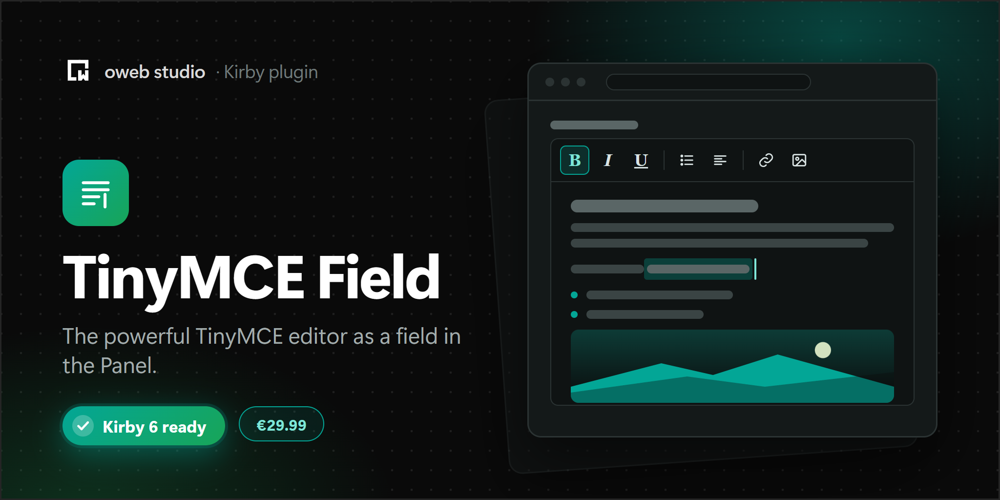

# Kirby TinyMCE Field

[](https://owebstudio.lemonsqueezy.com/checkout/buy/1f3ad982-7cfa-4f53-a1c2-fc2d12d80b2f)

Integrates the powerful **TinyMCE 8** wysiwyg editor into Kirby.

All the documentation about TinyMCE is in [the official documentation](https://www.tiny.cloud/docs/tinymce/latest/).


## Requirements

- Kirby 6
- PHP 8.3 or newer
- TinyMCE 8, either from Tiny Cloud with your own API key or from your own server (see [Loading TinyMCE](#loading-tinymce)). The plugin doesn't include TinyMCE.

## Kirby compatibility table

| Kirby version | Compatible plugin version |
|:--------------|:--------------------------|
| ^3.6          | ^1.0                      |
| ^4.0          | ^2.0                      |
| ^5.0          | ^2.0                      |
| ^6.0          | ^3.0                      |

## Installation

1. Download the latest release
2. Unzip downloaded file
3. Copy/paste unzipped folder in your `/site/plugins` folder

## Loading TinyMCE

### Tiny Cloud

Get an API key for free in your [Tiny account](https://www.tiny.cloud/docs/tinymce/latest/cloud-quick-start/) and add the domains of your Panel to the approved domains of your account. Then add the key to your config:

```php
<?php

// /site/config/config.php
return [
    'owebstudio.tinymce' => [
        'apiKey' => 'YOUR_API_KEY'
    ]
];
```

The field loads TinyMCE 8 from `cdn.tiny.cloud`. Use the `cloudChannel` option to load another release channel, e.g. `8.1`.

### Your own server

[Download TinyMCE](https://www.tiny.cloud/docs/tinymce/latest/zip-install/), put it in your `assets` folder and set `scriptSrc` to the URL of `tinymce.min.js`. TinyMCE 8 needs a [license key](https://www.tiny.cloud/docs/tinymce/latest/license-key/) when you host it yourself, otherwise the editor is read-only: use `gpl` if you use TinyMCE under the GPL, or your commercial license key.

```php
<?php

// /site/config/config.php
return [
    'owebstudio.tinymce' => [
        'scriptSrc' => 'assets/tinymce/tinymce.min.js',
        'licenseKey' => 'gpl'
    ]
];
```

`scriptSrc` wins over `apiKey`. Without either of them, the field shows a notice instead of the editor.

## Usage

```yaml
fields:
    text:
        type: tinymce
        label: "Content"
        placeholder: "Enter text.."
        height: 750
```

## Options

| Option          | Type                 | Description                                                                                                                                   |
|:----------------|:---------------------|:----------------------------------------------------------------------------------------------------------------------------------------------|
| height          | int string           | Sets the height of the entire editor, including the menu bar, toolbars, and status bar.                                                       |
| imageAdvanceTab | boolean              | Advanced tab to the image dialog allowing you to add custom styles, spacing and borders to images.                                            |
| menubar         | string boolean       | Allows you to specify which menus should appear and the order that they appear in the menu bar at the top of TinyMCE.                         |
| placeholder     | string               | Adds placeholder content that will be shown when the editor is empty.                                                                         |
| plugins         | array string         | Used to include plugins for the editor. Check out the [plugins](https://www.tiny.cloud/docs/tinymce/latest/plugins/).                         |
| toolbar         | string array boolean | Allows you to specify the buttons and the order that they will appear on TinyMCE's toolbar. Array items are groups.                           |

All the values can be updated in the `config.php` file with prefixed `owebstudio.tinymce.`

These options only work in the `config.php` file:

| Option       | Type   | Description                                                                 |
|:-------------|:-------|:----------------------------------------------------------------------------|
| apiKey       | string | Your Tiny Cloud API key                                                     |
| cloudChannel | string | The Tiny Cloud release channel, `8` by default                              |
| licenseKey   | string | The license key of a self-hosted TinyMCE: `gpl` or your commercial key      |
| scriptSrc    | string | The URL of a self-hosted `tinymce.min.js`, absolute or relative to the site |

## Defaults

| Option          | Default                                                                                                                                                                                                  |
|:----------------|:---------------------------------------------------------------------------------------------------------------------------------------------------------------------------------------------------------|
| apiKey          | null                                                                                                                                                                                                     |
| cloudChannel    | 8                                                                                                                                                                                                        |
| height          | 500                                                                                                                                                                                                      |
| imageAdvanceTab | true                                                                                                                                                                                                     |
| licenseKey      | null                                                                                                                                                                                                     |
| menubar         | file edit view insert format tools table help                                                                                                                                                            |
| placeholder     | null                                                                                                                                                                                                     |
| plugins         | ['advlist autolink lists link image charmap preview anchor', 'searchreplace visualblocks code fullscreen', 'insertdatetime media table help wordcount']                                                  |
| scriptSrc       | null                                                                                                                                                                                                     |
| toolbar         | undo redo &#124; blocks &#124; bold italic forecolor backcolor &#124; alignleft aligncenter &#124; alignright alignjustify &#124; bullist numlist outdent indent &#124; removeformat &#124; code fullscreen |

## Upgrading from 2.x

Version 3 uses TinyMCE 8 instead of TinyMCE 5. Your content stays as it is. Most options keep working:

- `print` and `paste` are part of the TinyMCE core now (File > Print, pasting is always on). The field skips them in `plugins`, like `hr`, `noneditable`, `colorpicker`, `textcolor`, `contextmenu` and `tabfocus`.
- The renamed toolbar buttons work with their old names: `formatselect` (now `blocks`), `fontselect` (`fontfamily`), `fontsizeselect` (`fontsize`) and `styleselect` (`styles`).
- `tc` (Tiny Comments, a premium plugin) is no longer in the default menu bar.
- Settings that you pass through a plugin (see below) must work with TinyMCE 8. The [migration guide](https://www.tiny.cloud/docs/tinymce/latest/migration-from-5x-to-8x/) lists all changes.

## Extending the plugin

If you want to extend the TinyMCE instance, you can do it by creating a sample plugin like the example below:

### Custom formatting examples

- https://www.tiny.cloud/docs/tinymce/latest/content-formatting/
- https://www.tiny.cloud/docs/tinymce/latest/user-formatting-options/

### Sample plugin

```javascript
panel.plugin("owebstudio/tinymce-extend", {
    thirdParty: {
        tinymce: {
            formats: {
                // Changes the default format for h1 to have a class of heading
                h1: {block: 'h1', classes: 'heading'}
            },
            style_formats: [
                // Adds the h1 format defined above to style_formats
                {title: 'My heading', format: 'h1'}
            ]
        }
    }
});

```

## License

TinyMCE Editor is a commercial plugin. It is free to use on your local computer and on staging sites. A live site needs a license key: [buy a license](https://owebstudio.lemonsqueezy.com/checkout/buy/1f3ad982-7cfa-4f53-a1c2-fc2d12d80b2f) and activate it with the button in the field's notice, or in the Panel's System view by clicking the license status of the plugin.

Without a license key, the editor is read-only on a live site and shows a notice. Your content stays visible and your website keeps working.

[oweb studio Commercial License](LICENSE.md). Versions released under the MIT license stay MIT. The current license is available at https://github.com/owebstudio/.github/blob/main/LICENSE.md.

TinyMCE itself is not part of the plugin. You load it from Tiny Cloud with your own API key or from your own server, under TinyMCE's own license, see [Loading TinyMCE](#loading-tinymce).
